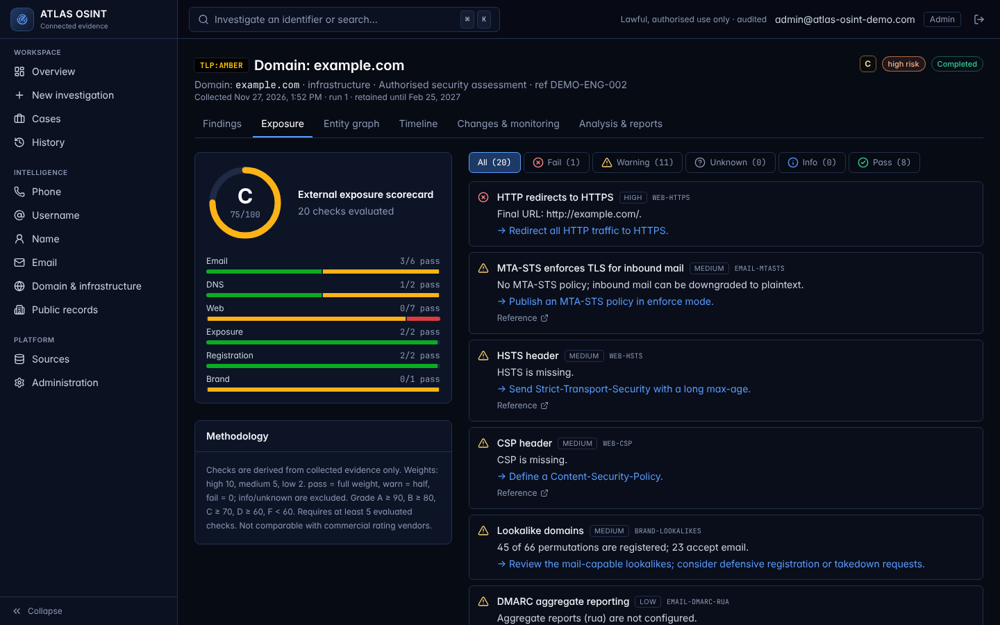
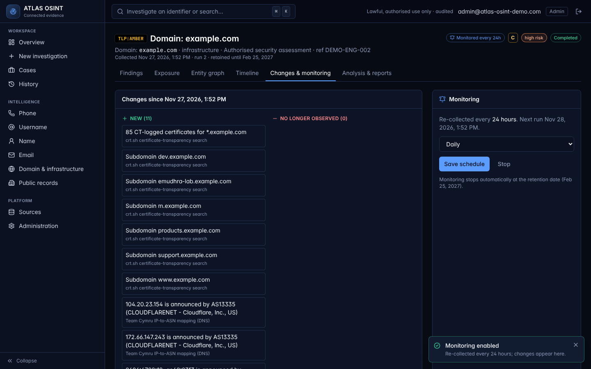
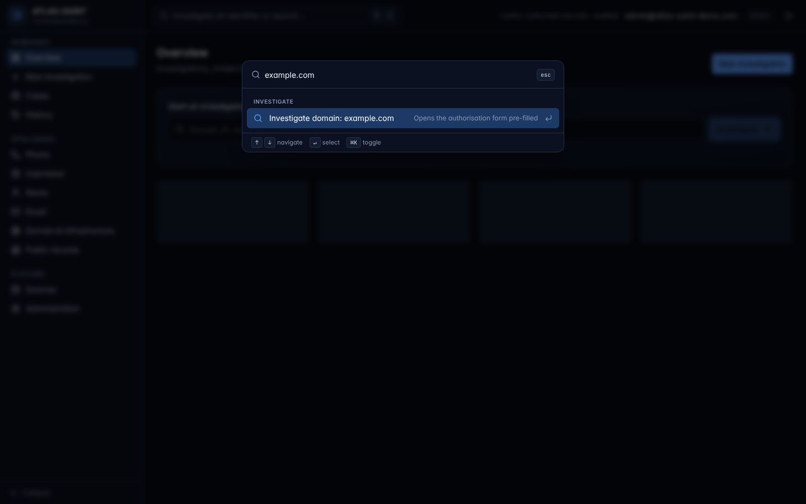

# ATLAS OSINT

**Open-source intelligence. Connected evidence. Verifiable insights.**

[](https://github.com/codesphere-u/atlas-osint/actions/workflows/ci.yml)
[](https://github.com/codesphere-u/atlas-osint/actions/workflows/codeql.yml)
[](LICENSE)


ATLAS OSINT is a self-hosted intelligence platform for **lawful, authorised** open-source investigations. Give it a
public identifier – a domain, IP, email address, phone number, handle, person or organisation name, or a public
document – and it queries **40 legitimate sources**, correlates what they say into an entity graph, scores every
finding with explainable rules, grades the target's external exposure, highlights risk, tracks change over time and
produces reports you can hand to a client or load into OpenCTI or MISP.

Every finding carries its source, URL, collection time, evidence excerpt, a SHA-256 of the raw response, a
confidence score with the rules that produced it, and a verification status an analyst can change.

> ATLAS is built for consent-based checks, due diligence, security assessments of assets you are authorised to
> test, research and journalism. It is **not** a people-search, stalking, doxxing or surveillance tool, and it
> contains technical controls that make it a poor one – see [Responsible use](#responsible-use).


<table>
<tr>
<td width="50%"></td>
<td width="50%"></td>
</tr>
<tr>
<td align="center">Exposure scorecard – every check explained, with a fix and a reference</td>
<td align="center">Entity graph – GLEIF corporate structure, inference edges dashed</td>
</tr>
<tr>
<td></td>
<td></td>
</tr>
<tr>
<td align="center">Change detection between runs and scheduled monitoring</td>
<td align="center">⌘K command palette – paste any identifier, the type is detected</td>
</tr>
</table>

## Capabilities

### Investigate any public identifier

| Input | What you get |
|---|---|
| **Domain / URL / IP** | DNS, RDAP registration, two certificate-transparency sources, archive history, BGP/ASN, RIR data, Shodan InternetDB exposure (open ports, CPEs, version-based CVEs), email security (SPF, DMARC, MTA-STS, TLS-RPT, BIMI, DNSSEC, DKIM), and – inside the authorised scope – web security headers, `security.txt` and **lookalike-domain discovery**. |
| **Organisation** | GLEIF LEI records with **parents and subsidiaries**, SEC EDGAR, UK Companies House, OpenCorporates, Wikidata, news coverage, and **sanctions / PEP / debarment screening** (OpenSanctions) that also records clear results. |
| **Username** | Exact-handle accounts on 12 platforms via official APIs, including **links verified by the platform** (Mastodon `rel=me`, Bluesky domain handles, Keybase proofs). Similar handles are flagged, never merged. |
| **Person name** *(consent required)* | OpenAlex, ORCID, Wikidata, Crossref publications linked through ORCID iDs, news mentions, and **name-collision detection**. |
| **Email** *(consent required)* | Syntax and provider analysis, mail-domain security, organisational-domain pivot, consent-gated breach *notification* (HIBP). No mailbox probing. |
| **Phone** *(consent required)* | E.164, validity, numbering-plan region, line type, range-allocated carrier. Never a subscriber identity. |
| **Public document** | Robots-aware retrieval, content hash, document metadata, outbound domains, archive history. |

The full list – access method, authentication, rate limit, licence, fields and reliability grade for each source –
is in [`docs/source-coverage.md`](docs/source-coverage.md). Sources are plugins ([guide](docs/writing-source-adapters.md)).

### Analyse

- **Explainable confidence** – a fixed rule set (reliability grade, match type, independent corroboration,
  contradictions, caps for name-only matches); every applied rule is shown. [Methodology](docs/confidence-methodology.md)
- **Conservative entity resolution** – merges only on persistent identifiers (ORCID, LEI, account IDs, normalised
  email/phone/domain). Names and handles never merge people. Measured on a labelled synthetic set: zero false merges.
- **Exposure scorecard** – an A–F grade built only from collected evidence; each check comes with its detail, a
  recommendation and an RFC/OWASP reference.
- **Risk highlights** – sanctions/PEP hits, exposed sensitive services, mail-capable lookalikes, breaches, dissolved
  entities and failed high-severity checks, each marked confirmed or requiring confirmation.
- **AI analyst that cannot invent facts** – optional Claude or self-hosted narrative over sanitised, envelope-wrapped
  data; statements must cite finding IDs and are downgraded when the evidence does not support their certainty.

### Work like an intelligence team

- **Cases & one-click pivots** – pivot from any linked identifier; the child inherits the authorisation record and
  joins a case with a **merged entity graph and timeline** across all its investigations.
- **Change detection & monitoring** – each re-run is compared with the last (only across sources that answered both
  times); schedule monitoring for organisations and infrastructure. Monitoring of individuals is deliberately
  unavailable.
- **TLP 2.0 & STIX 2.1** – every investigation and case carries a Traffic Light Protocol marking that is applied to
  reports and to **STIX 2.1 bundles** using the official OASIS marking definitions (validated with the `stix2` library).
- **Reports** – PDF (TLP on every page), HTML, JSON, CSV and STIX, with executive summary, scorecard, findings,
  contradictions, methodology, coverage limitations and analyst notes.
- **Analyst UI** – command palette with identifier auto-detection, split-pane findings with keyboard navigation and
  bulk verification, interactive graph (force/radial layouts, focus mode, search, SVG/PNG export), evidence
  timeline with histogram, exposure, changes, cases, source management and administration.

## Deploy to production

On a Linux server with Docker and a DNS record pointing at it:

```bash
git clone https://github.com/codesphere-u/atlas-osint.git && cd atlas-osint
```

```bash
./deploy/setup.sh --domain atlas.example.org --admin-email you@example.org
```

```bash
sudo docker compose up -d --build && sudo ./deploy/check.sh
```

`setup.sh` generates every secret and a one-time admin password; Caddy obtains the TLS certificate; `check.sh`
verifies health, TLS, headers and backups. Scheduled backups, restore, upgrades, IP allow-listing and a production
checklist are covered in the [deployment guide](docs/deployment.md). For a local trial use `--domain localhost`.

## Development

```bash
python -m venv .venv && . .venv/bin/activate && pip install -e ".[dev]"
```

```bash
ATLAS_BOOTSTRAP_ADMIN_EMAIL=admin@example.org ATLAS_BOOTSTRAP_ADMIN_PASSWORD='Change-Me-Now-2026' uvicorn atlas_api.main:app --reload
```

```bash
cd apps/web && npm ci && npm run dev
```

The web app runs on <http://localhost:3000> and proxies `/api` to the API on port 8000 (SQLite and the inline task
backend with a built-in scheduler are used by default; no Redis needed for development).

```bash
pytest                      # 200+ offline tests (HTTP and DNS are mocked)
pytest -m live              # optional checks against real public sources
ruff check . && mypy && bandit -c pyproject.toml -r shared engine modules integrations workers apps/api
cd apps/web && npm run typecheck && npm run lint && npm test && npm run build
```

## Repository layout

```
apps/api        FastAPI application (auth, RBAC, investigations, cases, reports, privacy, admin)
apps/web        Next.js + TypeScript + Tailwind analyst dashboard
engine/         collectors · normalization · correlation · verification · assessment · analysis · reporting · changes
modules/        phone · username · name · email · domain · public_records (plans, pivots, guardrails)
integrations/   sources (40 adapters + plugin registry) · providers (LLM providers)
shared/         config, domain types, SSRF-safe HTTP, DNS (system/DoH), privacy policy, crypto, rate limiting, logging
workers/        Celery worker + beat (investigations, monitoring, retention purge)
tests/          unit · integration · security · fixtures (synthetic data only)
docs/           architecture, research, methodology, security audit, coverage, deployment, test results
```

## Documentation

| Document | Contents |
|---|---|
| [Architecture](docs/architecture.md) | Components, data flow, data model, design decisions |
| [Research](docs/research.md) | Survey of OSINT tools and intelligence platforms; what ATLAS adopted and why |
| [Confidence & assessment methodology](docs/confidence-methodology.md) | Scoring rules, classification, entity resolution, scorecard, change detection |
| [Writing source adapters](docs/writing-source-adapters.md) | Plugin contract and checklist |
| [Source coverage](docs/source-coverage.md) | Generated table of every adapter |
| [API](docs/api.md) | Endpoint reference (OpenAPI at `/api/docs`) |
| [Deployment](docs/deployment.md) | Docker Compose, TLS, secrets, DNS, backups, upgrades |
| [Security audit](docs/security-audit.md) | Threat model, controls, findings, residual risks |
| [Test results](docs/test-results.md) | What is tested, results, entity-resolution metrics |
| [Feature status](IMPLEMENTATION_STATUS.md) · [Tasks](TASKS.md) · [Changelog](CHANGELOG.md) | Honest status per requirement |
| [Limitations & roadmap](docs/limitations-and-roadmap.md) | Known gaps and planned work |

## Responsible use

ATLAS enforces, in code:

- an **authorisation record** for every investigation (purpose, legal basis, reference, attestation), stored and audited;
- **consent or self-investigation** as the only legal bases for profiling an individual;
- **no private data categories** for individuals: residential addresses, precise locations, private contact details,
  financial data, credentials, dates of birth and sensitive attributes are stripped before storage;
- **scope enforcement** for anything that touches or targets infrastructure (active requests, subdomain listings,
  lookalike discovery);
- **no monitoring of individuals** – scheduled re-collection is limited to organisations and infrastructure;
- **pivots re-check the rules** – a pivot inherits the authorisation but consent rules are evaluated again;
- **opt-out / correction / deletion** requests from data subjects (public form at `/privacy`);
- **retention limits** with automatic deletion, and an append-only audit trail without raw identifiers.

Read [`PRIVACY.md`](PRIVACY.md) and [`SECURITY.md`](SECURITY.md) before deploying. You are responsible for complying
with the laws that apply to you (e.g. GDPR/UK GDPR, CCPA) and with each source's terms of use.

## Contributing

Contributions are welcome – especially new **legitimate** source adapters. Read [CONTRIBUTING.md](CONTRIBUTING.md)
and the [Code of Conduct](CODE_OF_CONDUCT.md) (it includes a strict no-misuse rule). Report vulnerabilities privately
via [GitHub security advisories](https://github.com/codesphere-u/atlas-osint/security/advisories/new).

## License

[Apache License 2.0](LICENSE). Data returned by sources remains subject to each source's licence (recorded per
finding, in reports and in [`docs/source-coverage.md`](docs/source-coverage.md)).
