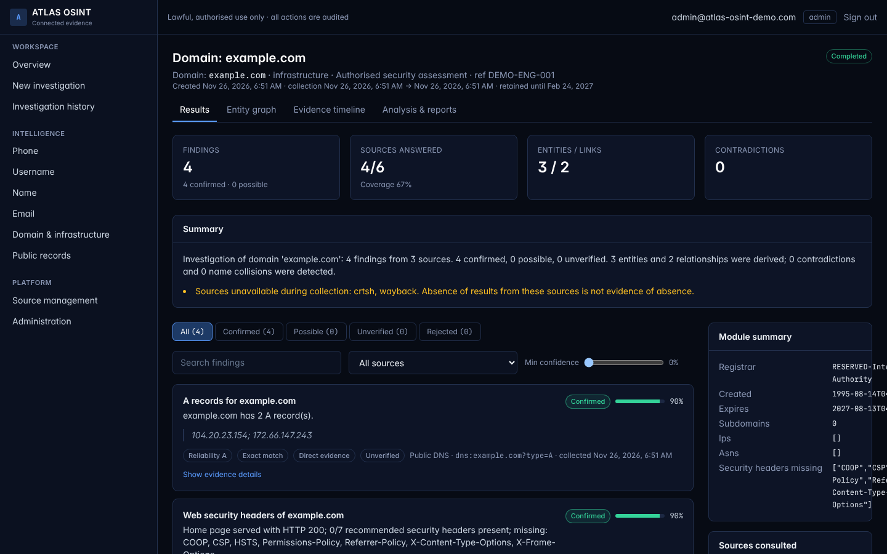
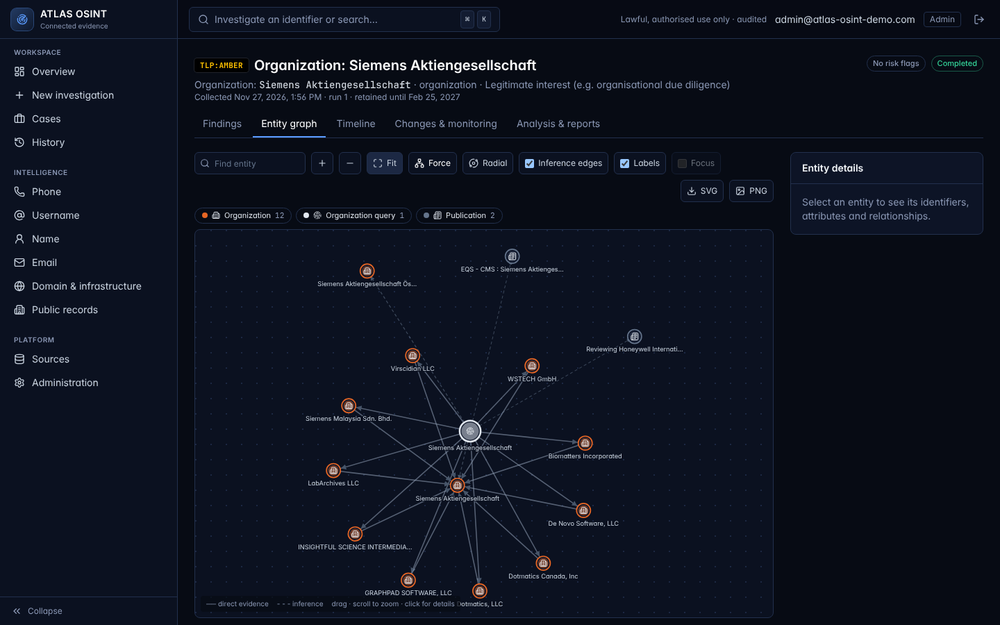
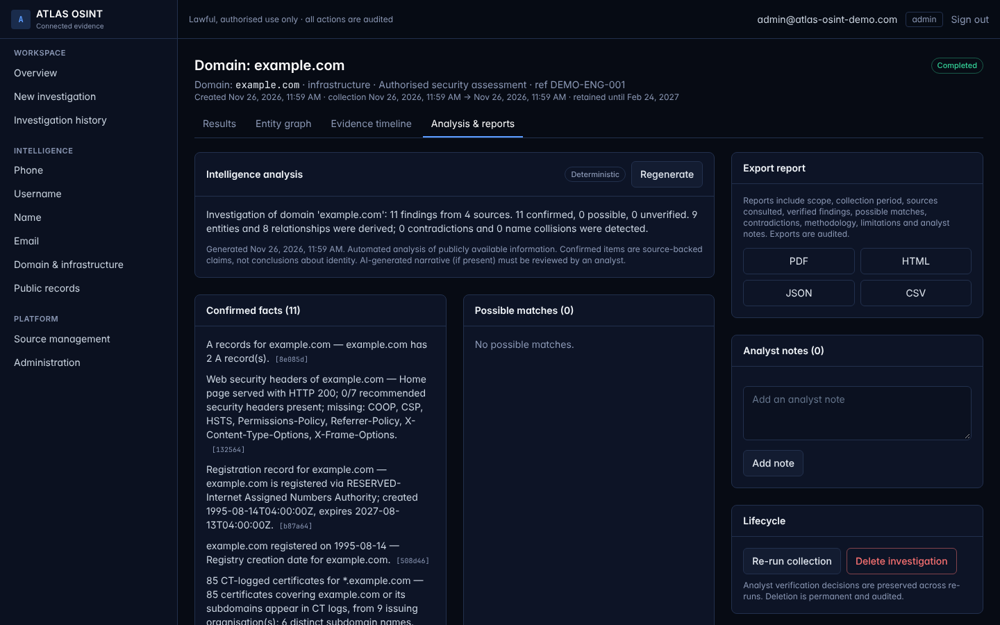

# ATLAS OSINT

**Open-source intelligence. Connected evidence. Verifiable insights.**

[](https://github.com/codesphere-u/atlas-osint/actions/workflows/ci.yml)
[](https://github.com/codesphere-u/atlas-osint/actions/workflows/codeql.yml)
[](LICENSE)


ATLAS OSINT is a self-hosted platform for **lawful, authorised** open-source intelligence work. It takes a public
identifier (phone number, username, name, email address, domain/URL/IP, organisation or public document),
queries a transparent set of legitimate public sources, and turns the results into **evidence-backed,
explainable intelligence**: every finding carries its source, URL, collection timestamp, evidence excerpt,
a rule-based confidence score with the reasons behind it, and a verification status an analyst can change.

> ATLAS is built for consent-based checks, due diligence, security assessments of assets you are authorised to
> test, research and journalism. It is **not** a people-search, stalking, doxxing or surveillance tool, and it
> contains technical controls that make it a poor one (see [Responsible use](#responsible-use)).



<table>
<tr>
<td></td>
<td></td>
</tr>
<tr>
<td align="center">Entity graph – namesakes kept separate, inference shown dashed</td>
<td align="center">Analysis &amp; exports (PDF, HTML, JSON, CSV)</td>
</tr>
</table>

## What it does

| Input | Module | What you get (examples) |
|---|---|---|
| Phone number | Phone | E.164 normalisation, validity, numbering-plan region, line type, range-allocated carrier, time zones. **Never** a subscriber identity. |
| Username | Username | Exact-handle accounts on 10 platforms via official APIs, similar-handle variants (flagged), cross-platform references stated by profiles, cryptographic Keybase proofs. |
| Full name | Name | Academic/professional/notable-person records (OpenAlex, ORCID, Wikidata) keyed by persistent IDs, news mentions, **name-collision detection**. |
| Email | Email | Syntax/provider analysis, MX/SPF/DMARC, passive pivot to the organisational domain, consent-gated breach *notification* (HIBP). No mailbox probing. |
| Domain / URL / IP | Domain | DNS, RDAP registration, certificate transparency, archive history, ASN/BGP mapping, RIR network data, and (only inside the authorised scope) security headers & technology fingerprint. |
| Organisation / document | Public records | GLEIF LEI records, SEC EDGAR, UK Companies House, OpenCorporates, Wikidata, GDELT news, public document metadata (robots.txt honoured). |

31 source adapters ship today; [`docs/source-coverage.md`](docs/source-coverage.md) lists every one with its access
method, authentication, rate limit, licence, fields and reliability grade. New sources are plugins
([guide](docs/writing-source-adapters.md)).

### Highlights

- **Provenance everywhere** – source name and URL, collection time, publication date, evidence excerpt, SHA-256 of
  the raw response, citation, finding ID.
- **Explainable confidence** – a fixed, documented rule set (reliability grade, match type, corroboration,
  contradictions, caps for name-only matches). Every applied rule is shown. See
  [`docs/confidence-methodology.md`](docs/confidence-methodology.md).
- **Conservative entity resolution** – records merge only on shared persistent identifiers (ORCID, LEI, account
  IDs, normalised email/phone/domain). Names and handles never merge people; collisions are flagged.
- **AI analyst that cannot invent facts** – optional Claude or self-hosted model narrative over sanitised,
  envelope-wrapped data; every AI statement must cite finding IDs and is downgraded if the evidence does not
  support its claimed certainty. A deterministic analyst (timeline, buckets, gaps) always runs.
- **Privacy & security by design** – authorisation records, consent enforcement for individuals, data-minimisation
  filter, opt-out/correction/deletion workflow, retention limits, encryption at rest, RBAC, API keys, audit log,
  SSRF protection with DNS pinning, rate limiting.
- **Reports** – PDF, HTML, JSON and CSV with scope, collection period, sources consulted, verified findings,
  possible matches, contradictions, methodology, coverage limitations and analyst notes.
- **Dashboard** – dark, responsive analyst UI: overview, module pages, results with filters and evidence cards,
  interactive entity graph, evidence timeline, source management, history, administration.

## Quick start (Docker)

```bash
git clone https://github.com/codesphere-u/atlas-osint.git
```

```bash
cd atlas-osint && cp .env.example .env
```

```bash
docker compose build api && docker compose run --rm --no-deps api atlas generate-keys
```

Paste the three generated keys into `.env`, set `POSTGRES_PASSWORD`, `REDIS_PASSWORD`,
`ATLAS_BOOTSTRAP_ADMIN_EMAIL` and `ATLAS_BOOTSTRAP_ADMIN_PASSWORD`, then:

```bash
docker compose up -d --build
```

Open <https://localhost> (Caddy issues a local certificate; set `ATLAS_DOMAIN` to a public hostname for automatic
Let's Encrypt). Full instructions: [`docs/deployment.md`](docs/deployment.md).

## Development

```bash
python -m venv .venv && . .venv/bin/activate && pip install -e ".[dev]"
```

```bash
ATLAS_BOOTSTRAP_ADMIN_EMAIL=admin@example.org ATLAS_BOOTSTRAP_ADMIN_PASSWORD='Change-Me-Now-2026' uvicorn atlas_api.main:app --reload
```

```bash
cd apps/web && npm ci && npm run dev
```

The web app runs on <http://localhost:3000> and proxies `/api` to the API on port 8000 (SQLite and inline task
execution by default; no Redis needed for development).

```bash
pytest                      # 172 offline tests (HTTP and DNS are mocked)
pytest -m live              # optional checks against real public sources
ruff check . && mypy && bandit -c pyproject.toml -r shared engine modules integrations workers apps/api
cd apps/web && npm run typecheck && npm run lint && npm test && npm run build
```

## Repository layout

```
apps/api        FastAPI application (auth, RBAC, investigations, reports, privacy, admin)
apps/web        Next.js + TypeScript + Tailwind analyst dashboard
engine/         collectors (orchestration) · normalization · correlation · verification · analysis · reporting
modules/        phone · username · name · email · domain · public_records (plans, pivots, guardrails)
integrations/   sources (31 adapters + plugin registry) · providers (LLM providers)
shared/         config, domain types, SSRF-safe HTTP, privacy policy, crypto, rate limiting, logging
workers/        Celery worker + beat (investigations, retention purge)
tests/          unit · integration · security · fixtures (synthetic data only)
docs/           architecture, methodology, security audit, coverage, deployment, research, test results
```

## Documentation

| Document | Contents |
|---|---|
| [Architecture](docs/architecture.md) | Components, data flow, data model, design decisions |
| [Research](docs/research.md) | Survey of existing OSINT tools (capabilities, limitations, licences) |
| [Confidence methodology](docs/confidence-methodology.md) | Scoring rules, classification, entity-resolution rules |
| [Writing source adapters](docs/writing-source-adapters.md) | Plugin contract and checklist |
| [Source coverage](docs/source-coverage.md) | Generated table of every adapter |
| [API](docs/api.md) | Endpoint reference (OpenAPI at `/api/docs`) |
| [Deployment](docs/deployment.md) | Docker Compose, TLS, secrets, backups, upgrades |
| [Security audit](docs/security-audit.md) | Threat model, controls, findings, residual risks |
| [Test results](docs/test-results.md) | What is tested, results, entity-resolution metrics |
| [Feature status](IMPLEMENTATION_STATUS.md) · [Tasks](TASKS.md) | Honest implementation status per requirement |
| [Limitations & roadmap](docs/limitations-and-roadmap.md) | Known gaps and planned work |

## Contributing

Contributions are welcome – especially new **legitimate** source adapters. Read [CONTRIBUTING.md](CONTRIBUTING.md)
and the [Code of Conduct](CODE_OF_CONDUCT.md) (it includes a strict no-misuse rule). Report vulnerabilities privately
via [GitHub security advisories](https://github.com/codesphere-u/atlas-osint/security/advisories/new).

## Responsible use

ATLAS enforces, in code:

- an **authorisation record** for every investigation (purpose, legal basis, reference, attestation), stored and audited;
- **consent or self-investigation** as the only legal bases for profiling an individual (configurable only by the operator);
- **no private data categories** for individuals: residential addresses, precise locations, private contact details,
  financial data, credentials, dates of birth and sensitive attributes are stripped before storage;
- **scope enforcement** for anything that touches a target's infrastructure (active requests, subdomain listings);
- **opt-out / correction / deletion** requests from data subjects (public form at `/privacy`);
- **retention limits** with automatic deletion, and an append-only audit trail without raw identifiers.

Read [`PRIVACY.md`](PRIVACY.md) and [`SECURITY.md`](SECURITY.md) before deploying. You are responsible for complying
with the laws that apply to you (e.g. GDPR/UK GDPR, CCPA) and with each source's terms of use.

## License

[Apache License 2.0](LICENSE). Data returned by sources remains subject to each source's licence (recorded per
finding and in reports).
